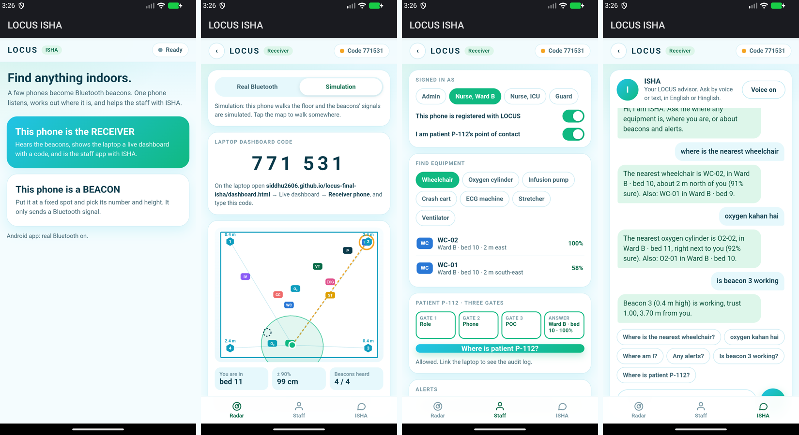

# LOCUS · ISHA

Indoor positioning with a few phones as Bluetooth beacons, a trust scorer (rules + ML) that ignores bad readings, and **ISHA**, a voice/chat advisor that tells hospital staff where equipment is. CodeApex 3.0 · Track 4 PS2 · Team V/Slash.

**Live:** https://siddhu2606.github.io/locus-final-isha/ · **Android app:** [latest release](https://github.com/siddhu2606/locus-final-isha/releases/latest)



## What is in it

| | |
|---|---|
| **Landing page** (`index.html`) | Cards to everything, live hero animation, "got a code?" box. |
| **Dashboard** (`dashboard.html`) | Source: **Demo** or **Receiver phone** (6-digit code). Layouts 2/3/4/6. Tabs **Beacons · Space · Radio · Objects · Report**. 3D view with heights (top / 3D / side). |
| **Trust scorer · rules + ML** | Every reading scored 0 to 1 by hand-written rules and a LightGBM model. **Rules + ML** (default): average when they agree, either can veto a bad reading. Cards show both scores. |
| **Off radar + self-check** | Tag silent to every beacon for 3 s → flag to its point of contact (last zone, time, trail). Beacon silent → repair alert. Works for every tagged object. |
| **Access · three gates** | Role → registered phone inside → point of contact. Answer is a zone, never coordinates. Audit log; two denials in a row are flagged. Staff phones' requests land here too. |
| **Moving beacons** | Drag a beacon, set it to *walks*, or call `update_beacon_position(id, x, y, t)`. Arrow, distance, bearing, dx/dy, trail and a log. LOCUS uses the new position and its uncertainty. Full study in `moving.html`. |
| **Tagged objects** | 11 predefined tags (2 wheelchairs, 2 oxygen cylinders, infusion pump, crash cart, ECG, stretcher, ventilator, patient P-112, nurse N-204), some move. Located by the same beacons. |
| **Phone app** (`phone.html`, same UI in the APK) | **This phone is a BEACON** (number + height) or **the RECEIVER** (real Bluetooth or simulation). Receiver = **Radar** (map, beacons, calibration, code) · **Staff** (find equipment, patient through the gates, alerts) · **ISHA** (voice or chat). |
| **ISHA** | Offline. "Where is the nearest wheelchair?", "oxygen kahan hai", "where am I", "is beacon 3 working", "any alerts", "where is P-112" (goes through the gates). Voice in and out (Android speech, or Chrome). |

## Carried beacons move on screen by themselves
Like LOCUS Trio, every beacon phone also **listens to the other beacons** and reads its **own motion sensors**. Its Bluetooth packet carries: moving yes/no, step count, compass heading, and the RSSI it hears from each other beacon (`L C id height flags steps heading/2 r1..r6`). When a beacon is carried, its steps and compass guess where it went, and its distances to the beacons that stayed put correct it (known walls on the floor plan are accounted for). The beacon-to-beacon radio model fits itself from the still beacons. No dragging needed; the receiver forwards everything to the dashboard.

Tested in simulation (`node scripts/test_beaconmove.js`, `node scripts/test_carry_browser.js`): a beacon carried 5 m ends 0.2-0.3 m from its true spot; while walking it stays within about 0.8 m; median 0.3-0.6 m in the open room, Home, Office and Hospital blueprints. Needs at least 2 beacons that stay put (1.2 m with only 2). On the emulator, 12 shakes gave 12 steps and the moving flag. Not yet tried with real phones being carried.

## Distance fix (13 cm read as 3.2 m)
A phone that really reads −70 dBm at 13 cm is called 3.16 m away if we assume the textbook −59 dBm at 1 m. Phones differ by 10 dB or more, so every beacon is now **calibrated at a known distance**: 10 cm, 50 cm, 1 m or 2 m (Beacons tab, or **Cal** on the phone). One distance sets the beacon's RSSI at 1 m; two distances also fit the fade exponent *n*. Ranges under 1 m are shown in cm. Tested: after calibration the same −70 dBm reads **13 cm**.

## Laptop dashboard by code
The receiver phone shows a 6-digit code. On any laptop open the dashboard → **Receiver phone** → type the code. Both need internet; the link goes through a public MQTT broker over secure WebSocket (our own 80-line client, three brokers as fallback), so it works across different Wi-Fi and mobile networks. Offline fallback: same Wi-Fi / hotspot, the app still serves the dashboard on port 8080.

## Run
```
python build.py && python -m http.server 8790      # http://localhost:8790/
cd android && ./gradlew assembleDebug                # needs JDK 17 + Android SDK 36
```
Bluetooth packet: manufacturer data `0xFFFF` = `L`, `C`, beacon id, height in dm.

## Tests
```
node scripts/test_units.js                # radio calibration, gates, ISHA, fused trust, dead beacon (27 checks)
node scripts/test_dashboard_browser.js    # every dashboard feature in headless Chrome (23 checks)
node scripts/test_link_browser.js         # phone <-> laptop by code, ISHA, staff request in the audit log (12, needs internet)
node scripts/test_moving.js && node scripts/test_moving_browser.js
```
The APK was installed on an Android 16 emulator: the page loads in the app, the native bridge works, Bluetooth advertising and scanning start, and the laptop dashboard linked to the app by its code.

## Honest limits
- Not yet tested with real phones as beacons in a room; the emulator has no real radio. Expect 1-2 m typical error with BLE, after calibration.
- Tagged objects (wheelchairs etc.) are simulated tags; only the receiver phone's own position comes from real Bluetooth.
- The code link uses a public broker: anyone who knows the code can read the stream. Fine for a demo, not for patient data.
- Accuracy numbers come from simulation with known ground truth. The ML was trained on a 40 × 24 m hospital floor; in a small room the rules carry more of the weight.
